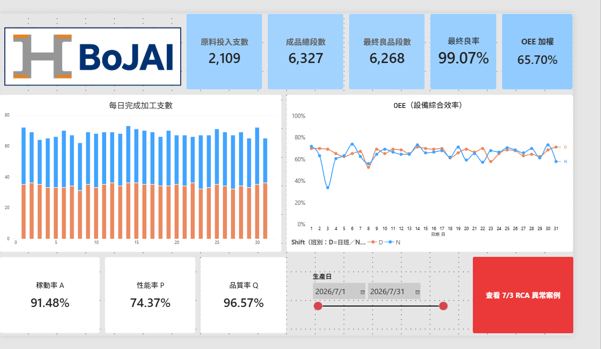
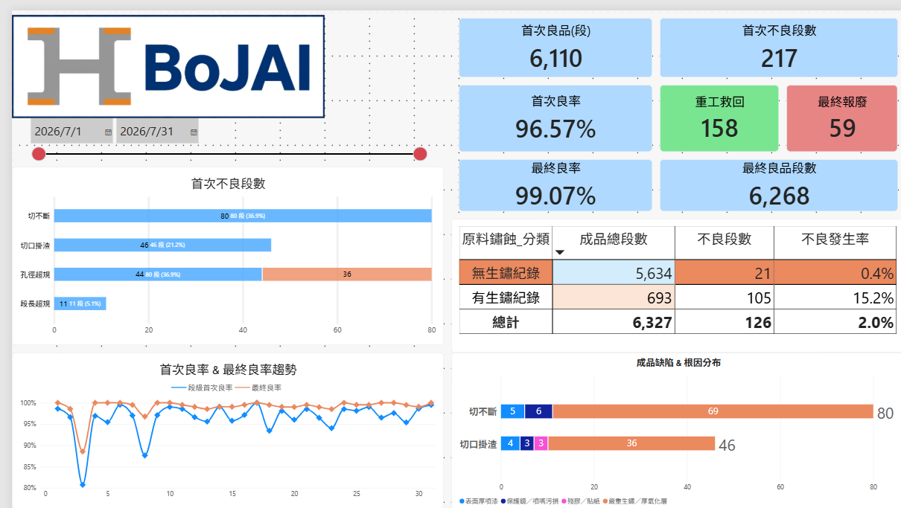
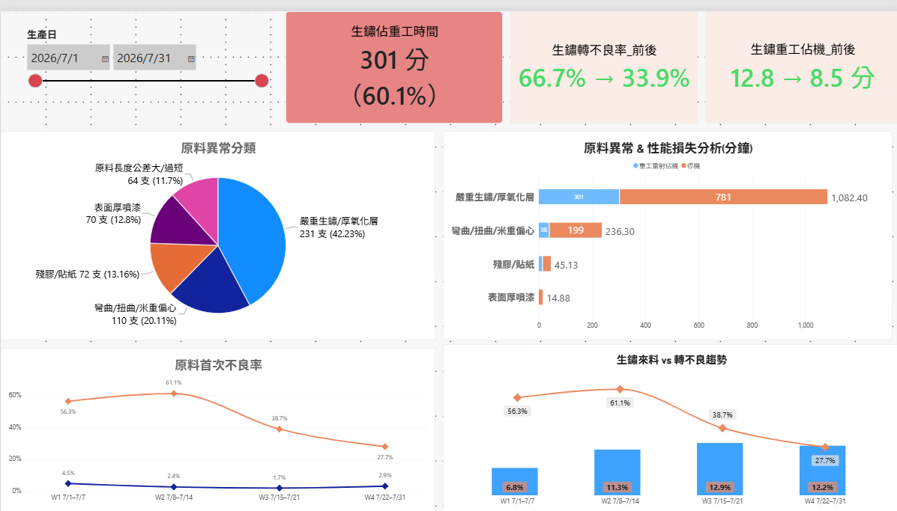
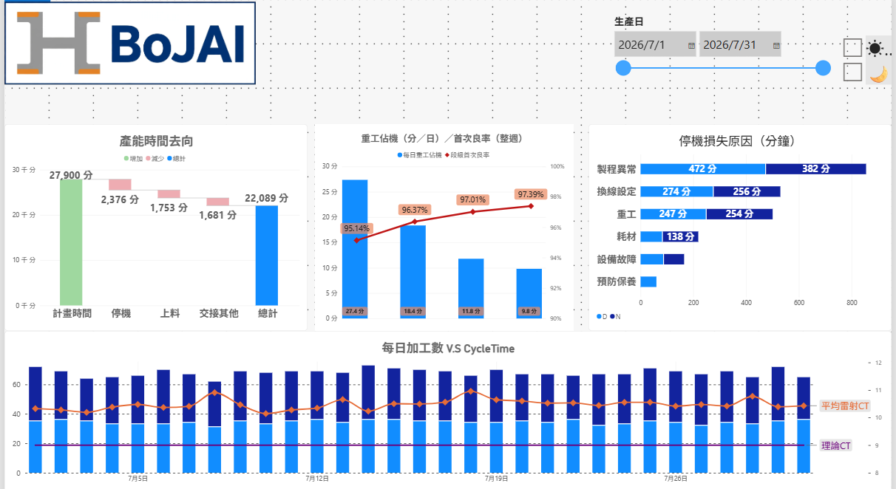
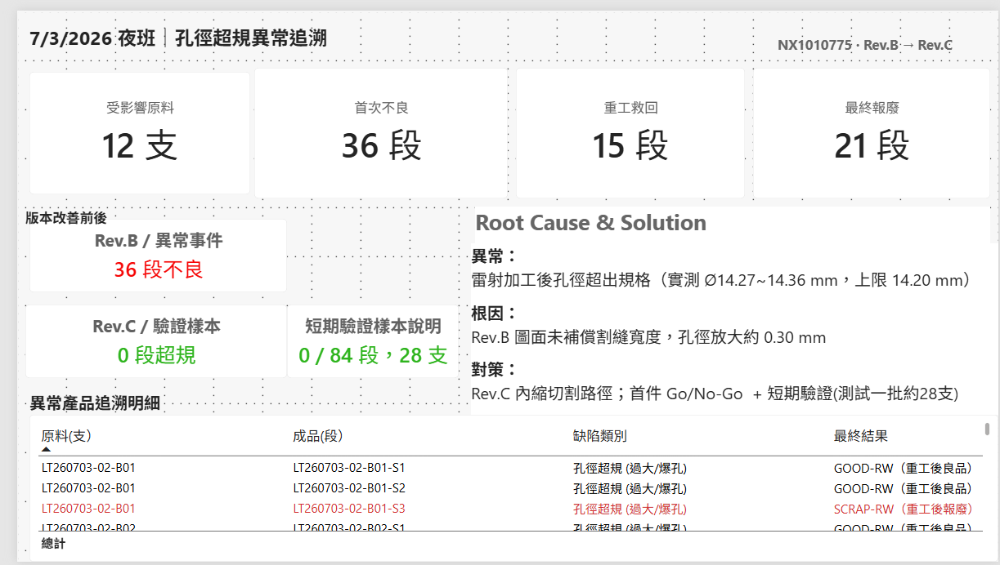

# 製造現場到數據分析｜Power BI 製程作品集  目前進度35%

> 以我在澳洲 **BoJAI 鋼材雷射加工現場**的工作經驗為背景，重新設計一份具有 MES（製造執行系統）資料結構概念的模擬資料，並使用 Power BI 練習產量、OEE、良率、重工、缺陷追溯與根因分析。
>
> **本作品為個人學習與求職展示，不是公司官方 MES，也不是實際產線的營運數字。** 2026 年 7 月的資料及改善情境均為模擬，Excel 模擬資料由 AI 協助生成，報表與分析流程在 AI 協作下完成。

## 為什麼做這個作品？

我之前在澳洲 BoJAI 擔任鋼材雷射加工的現場技師。現場很多生產、檢查與異常紀錄都是以紙本保存。遇到切不斷、切口掛渣、原料生鏽或孔位異常時，我通常是依照現場狀況和經驗，判斷要先檢查材料、機台還是加工參數。

回台灣後，我想換一個角度重新看這些問題：**如果把每天的加工、停機、品質與重工紀錄整理成可以互相追溯的資料，能不能找出單靠當下經驗不容易發現的規律？**

所以我用熟悉的加工流程作為原型，練習建立模擬 MES 式資料架構，再用 Power BI 觀察產能損失、品質波動與異常原因。這不是為了證明我已經完成工廠的數位化改造，而是希望在轉往製程相關工作前，訓練自己用數據提出問題、核對證據和規劃改善的方法。

## 專案範圍

- **製程情境：** 工字鋼雷射切割與孔位加工；每支原料對應三段成品，透過 `Bar_ID`、`Seg_ID` 與 NX 料號建立追溯關係。
- **模擬期間：** 2026 年 7 月，含日班與夜班。
- **資料設計：** 以原料、成品段、班別、工站、停機、重工、缺陷、物料及異常事件等明細建立分析關係。
- **分析工具：** Excel、Power Query、Power BI、DAX；開發與資料整理過程使用 AI / Claude Code 協作。

## 主要分析內容

| 分析主題 | 我想回答的問題 |
|---|---|
| 生產總覽與 OEE | 每天加工多少支？設備稼動率、性能率和品質率如何影響整體效率？ |
| 品質與缺陷 | 首次良率與最終良率差在哪？哪些缺陷最多？多少段被重工救回？ |
| 原料異常 | 生鏽等來料狀態與切不斷、切口掛渣是否存在關聯？ |
| Cycle Time／產能損失 | 理論加工時間與實際工時差在哪？停機、上料、交接及 CT 超時各占多少？ |
| RCA／異常追溯 | 如何從異常日期一路追到原料、成品段、圖面版本、重工與處置結果？ |

### 模擬資料中的幾個數字

本次七月情境包含 **2,109 支原料、6,327 段成品、6,268 段最終良品**，全月最終良率 **99.07%**、OEE 約 **65.70%**。

其中，我特別用缺陷排名找出「切不斷」與「切口掛渣」兩類問題，接著用原料編號回查鏽蝕紀錄，練習比較不同來料群組的缺陷發生率，而不只是看不良數量。另用 7/3 孔徑超規的模擬事件，練習建立異常處置、版本修正與成品追溯的分析流程。

> 以上結果是**模擬資料的分析結果**，不是我在 BoJAI 現場實際創造的良率、OEE 或產能改善績效。

## 報表畫面

### 01｜生產總覽：OEE 與每日產出

### 02｜良率與缺陷：首次不良、重工救回、最終報廢

### 03｜原料異常：生鏽、停機與品質損失

### 04｜Cycle Time：產能與時間損失

### 05｜RCA 案例：孔徑超規、版本修正與成品追溯

## 我在這次練習中學到什麼？

- 同一個數字的分母可能不同：例如「不良占比」和「缺陷發生率」不能混用。
- 最終良率高，不代表首次加工就穩定；需要同時看重工投入與最終報廢。
- 一次性異常可能讓整月排名失真，應把事件影響與日常缺陷分開看。
- 工程分析不應只有漂亮的圖表，還要能回到明細、說明計算口徑，並區分「已驗證結果」與「待驗證的原因假設」。

## 展示與資料說明

這個 GitHub 倉庫提供**作品介紹與報表截圖**；Power BI `.pbix` 原檔由我在面試時於電腦上操作展示，不在公開倉庫提供下載。為避免誤認，本專案沒有取得、公開或重現雇主的正式 MES 系統與真實生產紀錄，圖面、異常及改善數字均以模擬練習為目的。
